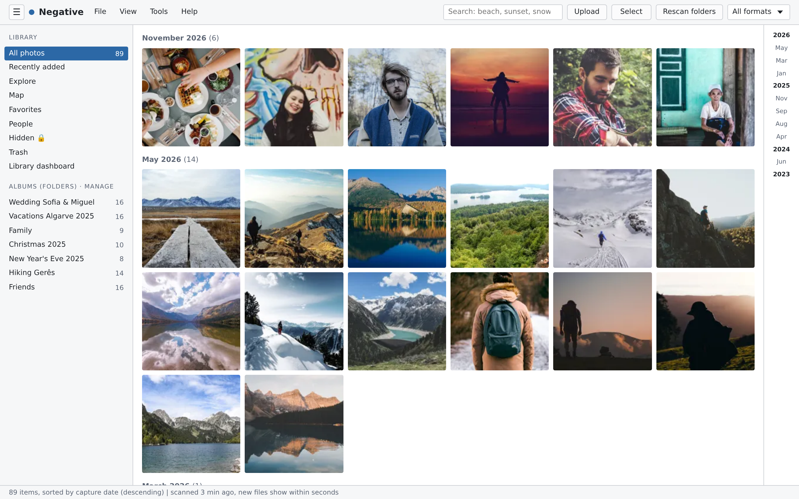
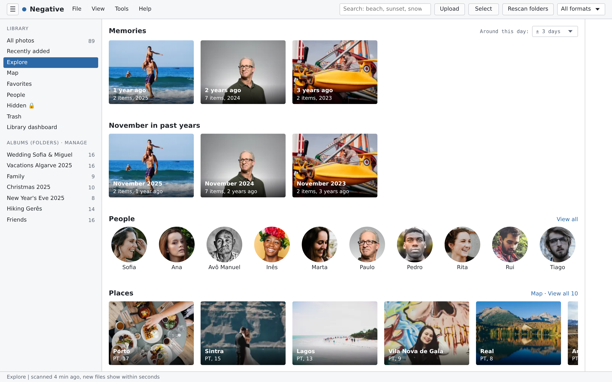
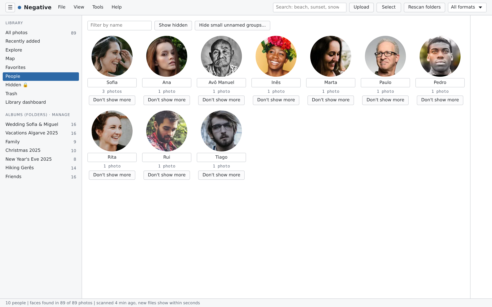

<p align="center"></p>

# Negative

A self-hosted photo server that works with the official Immich iPhone app, without importing or copying your library. Your folders stay where they are and are only read; each folder becomes an album. It also does offline face grouping, Memories, Places, Live Photos and QR sign-in.

*The originals are never touched, like negatives in a darkroom.*

 Built with Claude Code. The bugs are now a team effort.

**Status: beta.** Tested with the Immich iPhone app 1.140.0. It runs my own library every day, but expect rough edges, and check [Supported app versions](#supported-app-versions) before you update the app.

Many people want the Immich app without running all of Immich (Postgres, Redis, the machine-learning container) and without moving their photos into it. With Negative you point the server at your folders and keep the app.

> Negative is not Immich and is not affiliated with the Immich project. None of its code comes from Immich: the API shapes come from Immich's public OpenAPI spec (clean-room). See [Supported app versions](#supported-app-versions).



| Explore | People |
|---|---|
|  |  |

The screenshots show a demo library of CC0 stock photos; the names are made up. More views, including the phone layout and dark mode: [docs/FEATURES.md](docs/FEATURES.md).

## What it does

- Each folder you pick, with its sub-folders, is an album. Negative never copies, moves or re-encodes your files. It writes to the library only when you ask: Delete moves a photo to the app's own trash (restorable for 30 days), and Upload saves into one upload folder.
- The Immich phone app signs in with your server URL, email and password and shows the timeline, albums, people, memories, places, map and search. Negative refuses phone backup (upload from the camera roll), so it never mirrors your camera roll.
- The web app works on the desktop and the phone: a timeline with a scrubber, albums, people, places and map, memories, smart search, slideshow, favorites, hidden photos behind a PIN, trash, conversions (HEIC to JPG, MOV to MP4, resize) and a library dashboard.
- Face grouping (OpenCV YuNet + SFace), search by words (CLIP ViT-B/32, ONNX) and the nearest city for a GPS position (GeoNames) run offline on the CPU. The image build downloads the models once; after that nothing leaves the machine. You can switch faces and search off separately, and the apps then hide them.
- It plays Live Photos (a photo plus a same-name `.mov`) and shows HEIC, AVIF, WebP and TIFF. A video the browser cannot play gets a cached MP4 copy, and the original stays as it is.
- On 18,000 photos the first scan took 7 s, and a rescan with no changes took under 1 s. Faces, thumbnails and search vectors fill in afterwards, in the background.

## Quick start

Negative runs as one container. A full Immich install has four (server, machine learning, PostgreSQL and Redis/Valkey): the first two images alone are about 0.9 GB, before the database images and the models it fetches on first start. Negative's image is 0.67 GB compressed with its models included. It keeps its state in SQLite, so there is no database server to run, upgrade or back up, and it used about 620 MB of RAM serving 23,700 photos and videos (measured 2026-11-19).

```sh
git clone https://github.com/ricardopsantos/Negative.git && cd Negative
cp .env.example .env        # set PHOTOS_LIBRARY to your photo folder
docker compose up -d       # pulls the ready-built image; add --build to build it here
```

The app listens on `127.0.0.1:9556`. Put a reverse proxy with HTTPS in front of it, because the Immich app needs HTTPS. The first visit creates your user, unless `PHOTOS_PASSWORD` is set. Then pick the folders that should be albums.

### Reverse proxy (example: Caddy)

```
photos.example.com {
    encode zstd gzip
    reverse_proxy 127.0.0.1:9556
}
```

Add `photos.example.com` to `PHOTOS_ALLOWED_HOSTS`.

### The Immich app

Install the Immich app from the App Store, enter `https://photos.example.com` as the server URL, then your email and password. Another device can sign in to the web app by QR code (File > Sign in on another device).

## Supported app versions

| Immich app | Platform | Server reports | Tested |
|---|---|---|---|
| 1.140.0 | iOS | Immich API 3.3.6 | 2026-11-19 |

The server speaks the API of Immich 3.3.6. A newer app release can call endpoints this server does not know yet. If that happens, please open an issue with the app version and the iOS version.

## Configuration

Set these in `.env` (see [`.env.example`](.env.example)):

| Variable | Default | Meaning |
|---|---|---|
| `PHOTOS_LIBRARY` | (required) | Host folder with your photos, mounted at `/library` |
| `PHOTOS_DATA` | `./data` | Host folder for the database, thumbnails, faces, trash and logs. Back this up |
| `PHOTOS_EMAIL` | `admin@photos.local` | Sign-in email when `PHOTOS_PASSWORD` is set |
| `PHOTOS_PASSWORD` | empty | Empty: the first visit creates the user |
| `PHOTOS_NAME` | from the email | Name shown in the apps |
| `PHOTOS_ALLOWED_HOSTS` | `localhost,127.0.0.1` | Host names accepted (others get 400) |
| `PHOTOS_PORT` | `9556` | Loopback port on the host |
| `PHOTOS_DEFAULT_ALBUMS` | empty | Folders picked as albums on the first start |
| `TZ` | `UTC` | Time zone for photos without one |
| `PHOTOS_CPUS`, `PHOTOS_MEMORY` | `2`, `2g` | Container limits |
| `PHOTOS_FACES`, `PHOTOS_CLIP` | `1`, `1` | Face detection (People) and smart search; `0` turns one off |
| `PHOTOS_IMAGE` | `ghcr.io/ricardopsantos/negative:latest` | Image to run; pin a version tag to choose when to upgrade |

The container also reads `PHOTOS_WATCH=0` (no file watcher; rescan every `PHOTOS_RESCAN_SECONDS`), `PHOTOS_UPLOAD_MAX_MB` (4096) and `PHOTOS_TOKEN_DAYS` (90; unused sign-ins expire).

The album list is also a file you can edit: `data/albums.yml`.

## Development

```sh
./buildAndRun.sh                 # venv + dev data in ~/.cache, runs on 127.0.0.1:9700
python3 -m pytest -q             # needs requirements-dev.txt
```

[REQUIREMENTS.md](REQUIREMENTS.md) lists the behaviour rules, each with the test that proves it. [docs/ENDPOINTS.md](docs/ENDPOINTS.md) lists what the server answers for the phone app.

Stack: Python, Flask, gunicorn, SQLite, OpenCV, ONNX Runtime, ffmpeg, Docker.

## AI disclosure

Parts of this project were written with the assistance of AI coding agents
(Claude Code). All changes are reviewed by the maintainer, who is responsible
for the code. This is the single place that fact is disclosed; it is
deliberately kept out of the commit history.

## Credits

What Negative builds on, and its relation to Immich: [CREDITS.md](CREDITS.md).

## License

MIT, see [LICENSE](LICENSE). Third-party parts and their licenses are listed in [THIRD-PARTY.md](THIRD-PARTY.md).
