# Negative in pictures

Every screenshot is the real web app, running on a demo library of CC0 stock photos (from Unsplash, via Wikimedia Commons) sorted into album folders. The people in them are models in stock photos; the names are made up for the demo.

## Timeline

All photos from every album on one timeline, newest first, grouped by month. The rail on the right jumps between months and years.

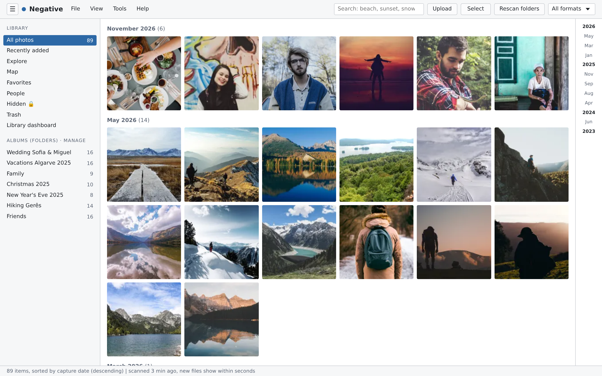

## Albums are folders

Each folder you pick, with its sub-folders, is an album. The sidebar lists them with their counts; the files stay where they are.

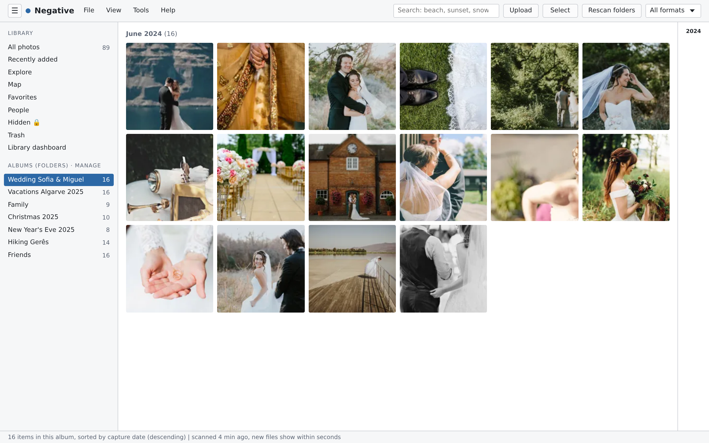

## Viewer

The viewer rotates a photo (the app stores the rotation and leaves the file alone), opens it at full size, and can favorite, download, hide, convert or delete it to the app's trash. Arrow keys and swipes move between photos.

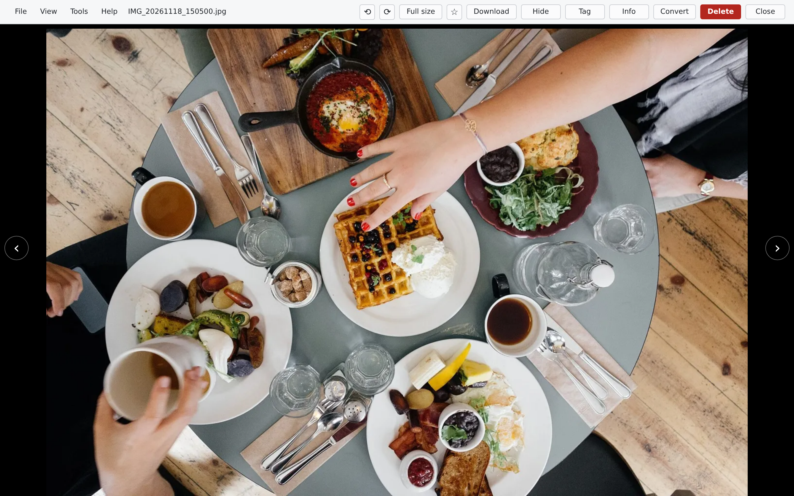

Info shows the file and EXIF data and where the date came from; for a photo with GPS, also the place near it and a link to the map.

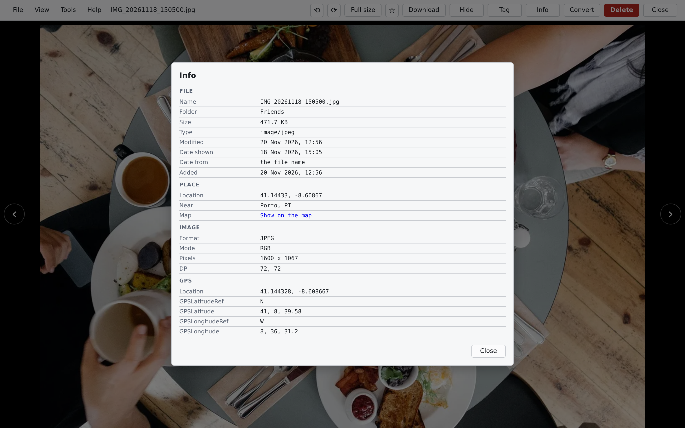

## Explore

Explore shows memories from this week in earlier years and from this month in past years, then your places.

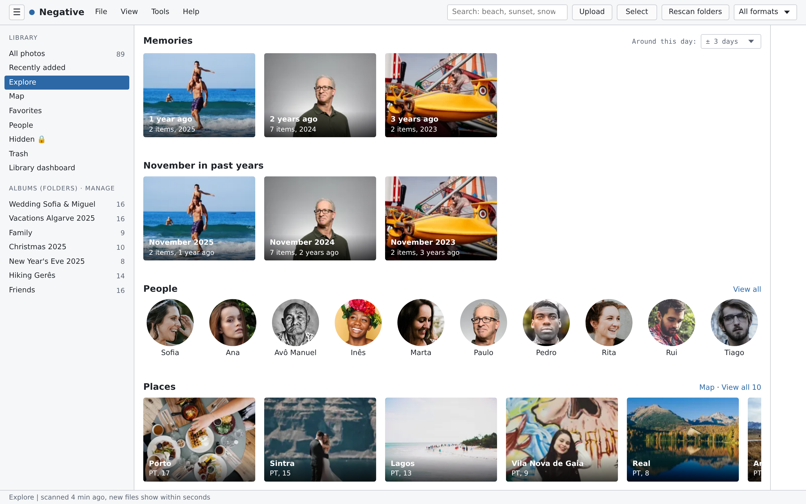

## Places and map

Places come from the photos' GPS data and an offline city list. The map needs no tiles and no internet, because Negative serves the world outline and the map library itself.

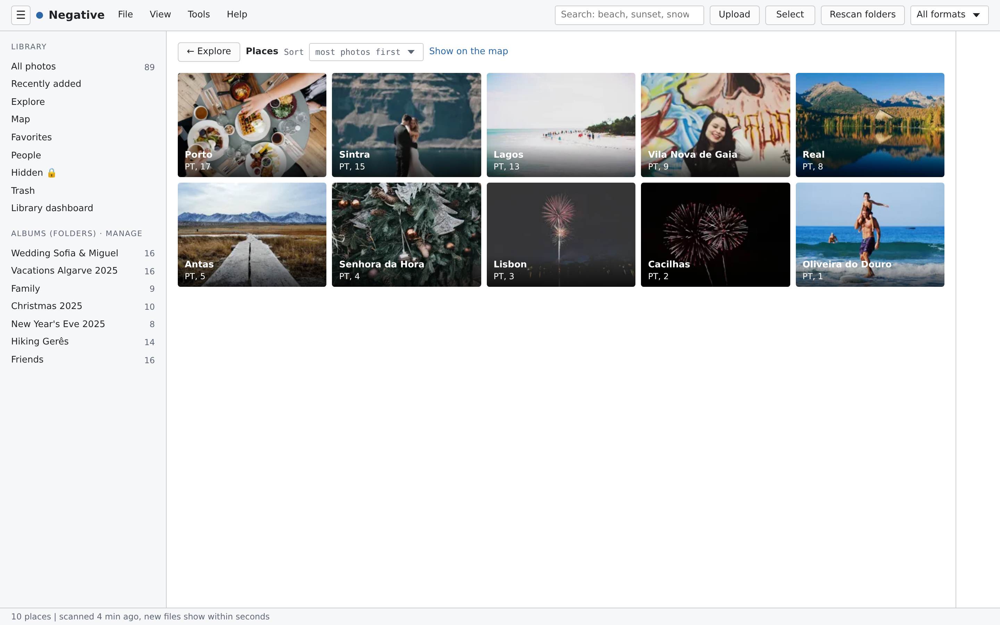

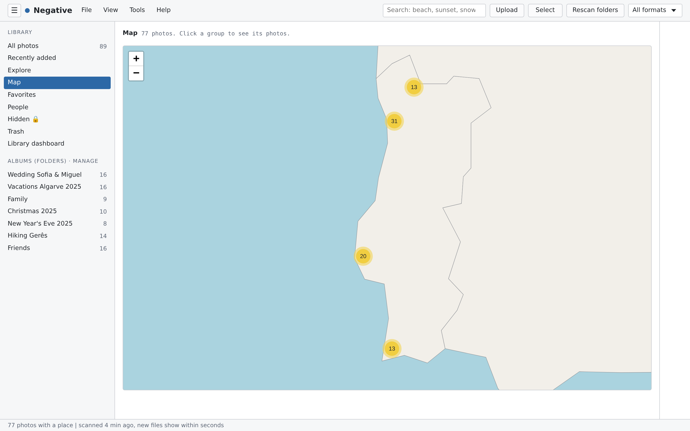

## Search by words

Smart search finds photos by what is in them ("sunset", "beach", "snow"), with a CLIP model running on the CPU. It sends nothing off the machine.

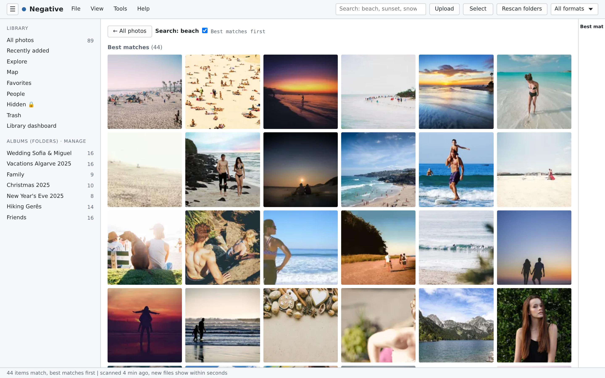

## People

Negative finds and groups faces offline (OpenCV YuNet + SFace, on the CPU). Name a group once and the name follows that person into every album, the viewer and the phone app.

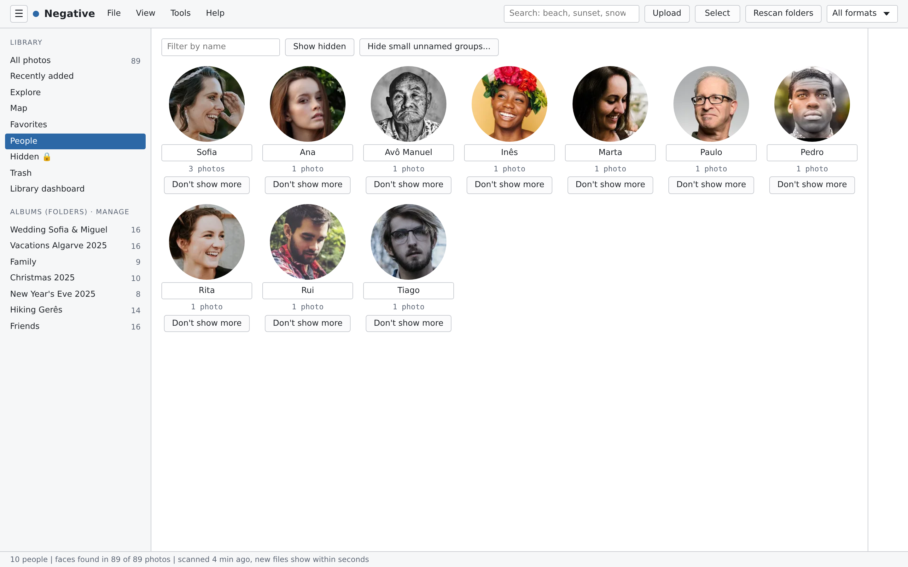

## Hidden photos

Hidden photos live in their own album behind a PIN, which you enter on a number pad. The timeline, search, memories, places and the phone sync all leave them out.

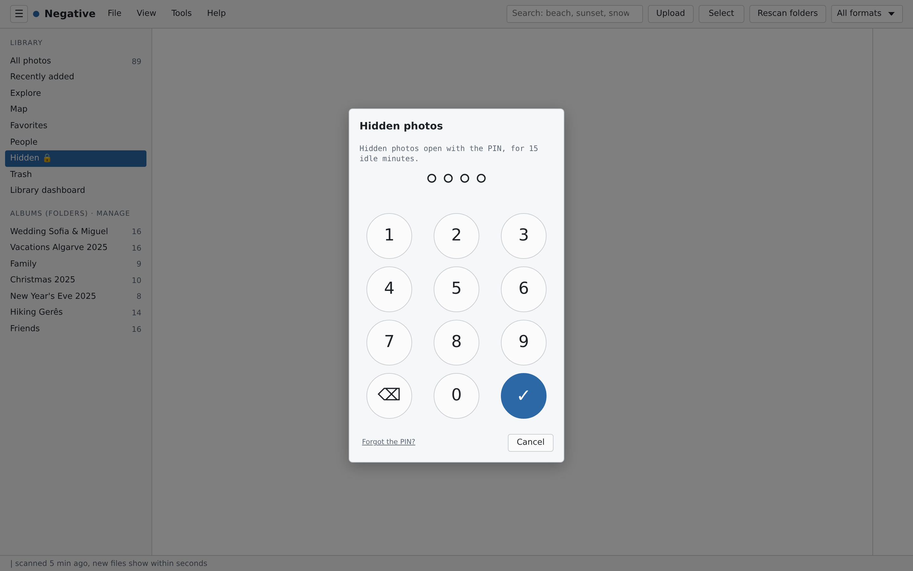

## Library dashboard

The dashboard shows counts, sizes and formats, the oldest and newest photo, and how far thumbnails, search and places have got.

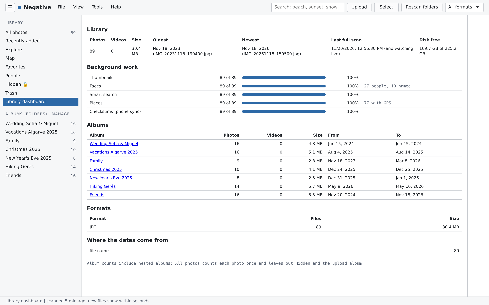

## On a phone

This is the same web app on a 390 px screen. The header fits in one row, you swipe between photos, and you pinch to zoom.

| Timeline | Explore |
|---|---|
| 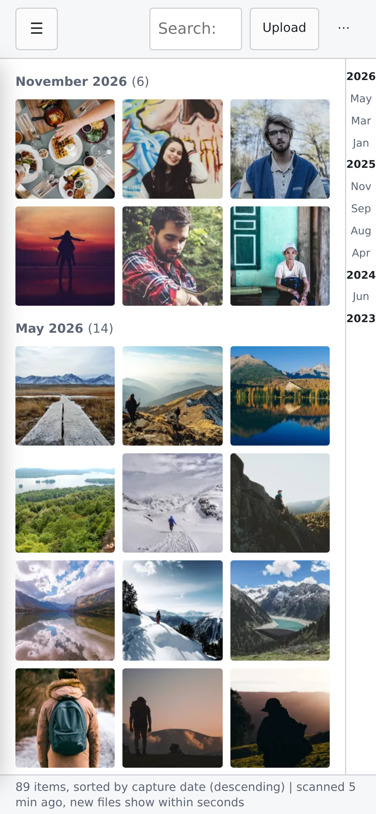 | 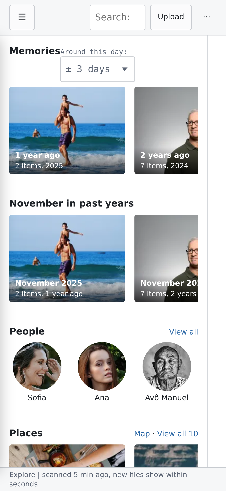 |

## Dark mode

Dark mode follows the system setting.

| Timeline | Explore |
|---|---|
| 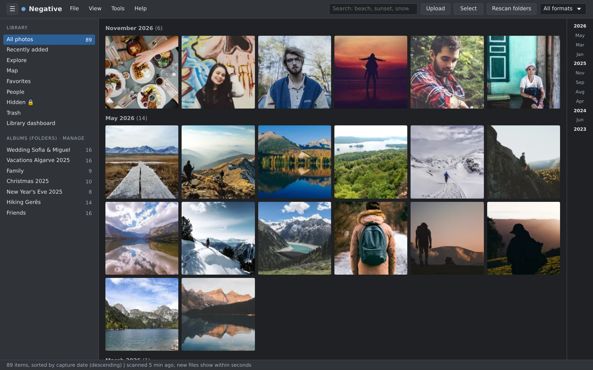 | 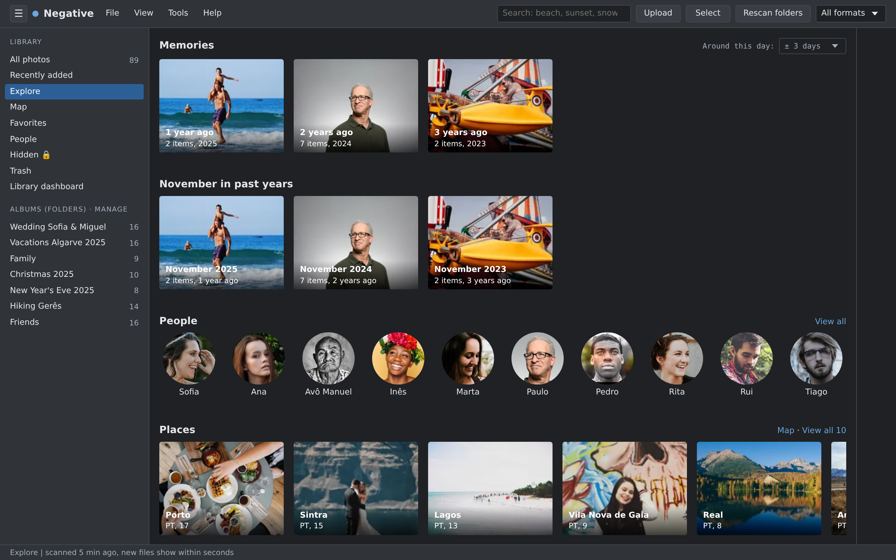 |

## The Immich phone app

The official Immich app signs in with your server's address, email and password and shows the same library: timeline, albums, people, memories, places, map and search. Screenshots of the phone app are still to come.
